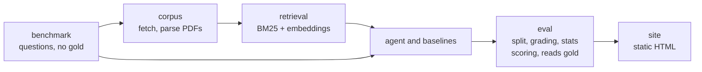

# footnote

An agent that answers questions about SEC filings and cites the quotes behind its answer.

Recording: (added when the site is published)
Live site: (link added when the site is published)

Footnote answers questions about SEC filings from the FinanceBench open sample,
then measures itself against simpler systems that use the same model, on a test split that is run
once.

- **Answers with quotes.** Each answer cites the filing page and the quotes behind it. A code
  check confirms the quotes appear on the cited pages and that the final number is a rounding of a
  quoted number or of a logged calculation over quoted numbers.
- **Compared on equal terms.** The agent is scored against three baselines (no documents, plain
  retrieval, long context) with the same model and the same grading; the systems that read
  documents all get the same filing.
- **Uncertainty.** Accuracy comes with a 95% interval that resamples whole companies, plus
  answer coverage, cost per question and latency. A static site shows each answer, its
  trace and the grader's verdict, including failures. Citations are shown only for answers whose
  quote check passed; otherwise the page says the quote was not found in the filing, or that it
  was not checked.

## Architecture

Dependencies run one way. The gold answers are read only by `eval` (to score) and `site` (to show the reference answer next to each result); nothing upstream can read them.



`tests/test_import_boundaries.py` statically checks imports (it parses the source for import statements) and fails if any upstream package imports `eval` or touches the raw benchmark rows. It does not detect dynamic imports.

## Results

Not yet available. The table is filled in after the single frozen run of each system on the test
split (57 questions, 11 companies). No number in this table is a measurement yet.

| System | Accuracy (95% interval, company-clustered) | Agent minus this system (paired 95% interval) | Answer coverage | Cost per question | Mean latency |
| :- | :-: | :-: | :-: | :-: | :-: |
| Without documents | - | — | - | - | - |
| Plain retrieval | - | — | - | - | - |
| Long context | - | — | - | - | - |
| Agent | - | reference | - | - | - |

The paired difference is the agent's accuracy minus the other system's on the questions both were
graded on, with an interval that resamples whole companies (the same ones for both systems).

Historical context only, from the FinanceBench paper (Islam et al., arXiv:2311.11944), GPT-4-Turbo,
November 2023, graded by humans: 19% with one shared vector store, 50% with one store per filing,
79% with long context, 85% when given the evidence pages. Different models, human grading and retrieval setups, so
these are not a baseline for the table above.

## Failure examples

Added from the real test run, sorted by type: declined, unsupported, retrieval miss, wrong number,
reasoning, error (`footnote failures` produces the per-run list). Failures are published, not
selected away. Failure types differ by system: "unsupported" applies only to the agent (the
baselines are checked afterwards without a calculator, and the no-documents system is not checked),
and "retrieval miss" applies only to systems that read pages.

## Design decisions

- **Explicit tool loop, no framework.** The agent is a plain loop over three tools (search the
  filing, read a page, calculate) with a call cap per question. Every step is a record the site can
  show, and spend limits are easy to see in the code.
- **Equal document access.** Every system is told which filing a question is about. The comparison
  then isolates how a system uses the document, not whether it can find it. Finding the filing
  among all 84 is a harder, separate setting that is not tested here.
- **Numbers are graded by code where possible.** A question is scored by code only if it is a
  metrics-generated question whose reference answer is a single number and the answer gives a
  structured final value (number and unit); the match uses a stated tolerance. Every other answer
  goes to a grader that is a different model from the agent, never told which system produced the
  answer, using a fixed rubric.
- **The split is frozen first.** Questions are split by company (no company in both halves) before
  any tuning, and the test split is run once per system family; a repeat is refused unless a reason
  is recorded. Development runs are labeled exploratory on the site.
- **Spend limits by construction.** Each call has input and output token caps, each question a call
  cap, and each run is admitted only if its worst-case cost fits under a $25 cap tracked in an
  append-only ledger. A crashed run stays charged its maximum.
- **Declining counts as a miss.** Every benchmark question has an answer, so a refusal is scored
  wrong, and answer coverage is reported beside accuracy.

## What the grounding check proves

After the agent submits, code checks two things.

1. Every quote it cites appears on the cited page of the filing, after normalizing whitespace, line breaks and
   hyphenation.
2. The final numeric answer is a correct rounding of a number in a cited quote, or the result of a
   logged calculation over quoted numbers (plus small constants such as /2, x100, x365).

It does not check numbers in the explanation text. It does not prove a number means what the answer
says: a quoted figure can be in the wrong units or for the wrong period and still pass. The grader
measures correctness; the check measures traceability.

## Data and license

- Questions and reference answers: the FinanceBench open sample (150 questions, 84 filings),
  Patronus AI, [arXiv:2311.11944](https://arxiv.org/abs/2311.11944), licensed CC BY-NC 4.0 on
  Hugging Face. Our reading is that non-commercial portfolio use fits that license; it is a reading,
  not a verified grant.
- The filings are the companies' public documents. The PDFs are downloaded at run time from the
  FinanceBench repository, pinned by SHA-256 in `data/corpus_manifest.json`, and never committed or
  redistributed. The site shows short attributed quotes and links to the source.
- Code: MIT.

Corpus quality, measured against the benchmark's own evidence passages (`results/corpus_quality.json`):
93.1% (176 of 189) are found on the right page by word coverage of at least 90%, and 33.3% match
character for character. The cause of the gap was not measured. The 13 passages below the threshold
are listed in that file; for those, the benchmark's own text runs table labels together without
spaces. The grounding check runs against our extracted text, not the benchmark's.

## Run locally

Python 3.12 or 3.13 and [uv](https://docs.astral.sh/uv/).

```
uv sync
```

The code reads settings from the process environment only; it does not load `.env`. Copy
`.env.example` as a checklist and export the variables in your shell (for example
`set -a; source .env; set +a`). `AZURE_OPENAI_ENDPOINT` and `AZURE_OPENAI_API_KEY` are required.
`FOOTNOTE_AGENT_DEPLOYMENT` and `FOOTNOTE_GRADER_DEPLOYMENT` default to `footnote-agent` and
`footnote-grader`; `FOOTNOTE_CACHE` (PDFs and indexes) defaults to `~/.cache/footnote`. The agent
are configured to gpt-5-mini (agent) and gpt-4.1-mini (grader) Azure OpenAI deployments, and the
prices in the code assume those models.

```
uv run footnote eval --system agent --split gate --run-id agent-gate-1
uv run footnote compare agent-gate-1 plain-gate-1      # paired difference with an interval
uv run footnote failures agent-gate-1                  # failures by type
uv run footnote site                                   # writes _site/
```

Systems are `no-docs`, `plain-retrieval`, `long-context` and `agent`. Splits are `dev` (93
questions, of which 30 form the `gate` set for pipeline checks) and `test` (57). Checks: `uv run ruff check .`,
`uv run mypy src`, `uv run pytest`.

## Limitations

- 57 test questions from 11 companies. Intervals are wide, and a difference inside them is not
  claimed.
- One benchmark, one model family for the agent, and a grader that is itself a model and can be
  wrong in both directions. Grader agreement checked against AI-written reference labels is an
  AI-reference estimate, not a human agreement rate.
- Equal document access hides the harder problem of finding the right filing.
- The no-documents result measures performance without documents, not memorization. The benchmark
  has been public since 2023 and may be in training data.
- Page references follow the benchmark PDF's zero-based page index plus one, which can differ from
  the number printed on the page.
- Some source links have gone dead. Where the original may be dead, the site keeps the original
  link and adds an SEC EDGAR search link beside it.
