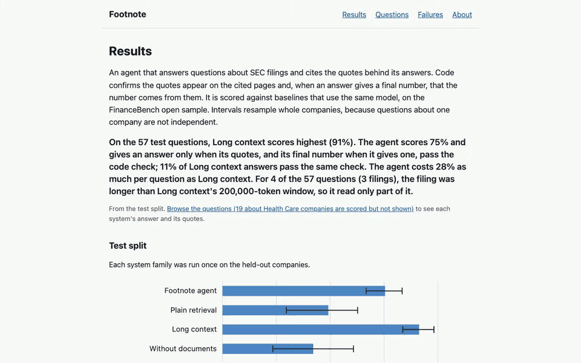
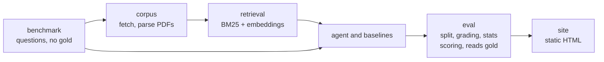

# footnote

An agent that answers questions about SEC 10-K filings and shows the exact quote behind every
answer.

Live site: https://cbai96cbai.github.io/footnote/



## Result

On 57 held-out test questions about 11 companies, long context is the most accurate system (91%).
The agent scores 75% and gives an answer only when its quotes, and its final number when it gives
one, pass the code check; 11% of long-context answers pass the same check. The agent costs 28% as
much per question as long context. It is well ahead of plain retrieval and of answering with no
documents. Each system was run once, on code frozen beforehand, with the same model, the same
filing per question and the same grading.

| System | Accuracy (95% interval) | Agent minus this system (paired) | Answered | Passed code check | Cost per question | Time per question |
| :- | :-: | :-: | :-: | :-: | :-: | :-: |
| Long context | 91.2% (83.7 to 98.1) | -15.8 pts (-26.3 to -6.7) | 98.2% | 10.7% | $0.0294 | 21.8 s |
| Agent | 75.4% (66.7 to 83.3) | reference | 91.2% | 100.0% | $0.0082 | 29.4 s |
| Plain retrieval | 49.1% (29.6 to 62.7) | +26.3 pts (+12.3 to +46.9) | 68.4% | 38.5% | $0.0020 | 22.0 s |
| No documents | 42.1% (23.3 to 60.8) | +33.3 pts (+14.0 to +53.1) | 91.2% | n/a | $0.0011 | 21.5 s |

Intervals resample whole companies, because questions about one company are not independent. The
paired difference is the agent's accuracy minus the other system's on the same questions, 10,000
resamples (`uv run footnote compare test-agent test-longctx`).

- **Passed code check** is the share of answered questions whose quotes were all found on their
  cited pages and whose final number traced to those quotes. An answer with no final number has
  only its quotes checked: 17 of the agent's 52 answers gave none. The agent's rate is 100% by
  construction, because it answers only once the check passes.
- The agent logs its calculations and retries a rejected answer, while the baselines are checked
  afterwards without logged calculations. So the pass rate describes how each system works, not
  which answers are right; accuracy does that.
- Time is the last attempt per question, measured while the four runs shared one rate limit.
  Three questions were re-run after rate-limit errors and only the final attempt's time is counted.
  Cost includes every attempt and the grading call.
- Long context read only part of the filing for 4 of the 57 questions (3 filings): they were
  longer than its 200,000-token window.
- Total spend: about $10.83 of Azure OpenAI calls for every development and test run (from the
  local spend ledger, which is not in the repository).

For context only: the FinanceBench paper (Islam et al., [arXiv:2311.11944](https://arxiv.org/abs/2311.11944),
GPT-4-Turbo, November 2023, graded by people) reported 19% with one shared vector store, 50% with one
store per filing, 79% with long context and 85% when given the evidence pages. Different models,
grading and setups, so not a baseline for the table, but the same ordering: reading the whole filing
beats retrieving pieces of it.

## What it does

- **Answers with quotes.** For each question the agent searches one filing, reads pages, does its
  arithmetic with a calculator tool, and submits an answer with the page and the exact quotes
  behind it. Code then checks that every quote is on its cited page and that the structured final
  number, when the answer gives one, traces to those quotes; the agent answers only when the check
  passes (details in
  [What the grounding check proves](#what-the-grounding-check-proves)).
- **An honest comparison.** Three baselines use the same model, the same filing and the same
  grading: no documents, plain retrieval of the top passages, and long context (as much of the
  filing as fits in 200,000 tokens).
- **A static site** shows every answer, its trace and the grader's verdict, failures included,
  except for questions about Health Care companies (19 of the 150), which are scored but not shown. A
  citation is shown only when its quote check passed; otherwise the page says "Quote not confirmed
  on the cited page" or "Cited page does not match", or that the answer was not checked.

## How it got here

The 93 development questions guided the agent; the test split was untouched until the code was
frozen. Scores below are correct answers out of 93.

- **Version 1** (a 30-question checkpoint, not in `results/`): 16 of 30, with 9 declines, most
  traced to the harness rather than to reading the filing (its number check rejected multi-step
  calculations, and the turn budget ran out before the retry); one was the model's own decision and
  one came from unclear quoting rules.
- **Version 2**: 67 and 62 (two runs). Chained calculations traced, the last two replies reserved
  for submitting, a search parameter the model misused removed, clearer quote rules.
- **Version 3**: 61 and 60. The retry was allowed to calculate. It made things worse: 16 to 17
  questions per run failed once and never resubmitted, found by comparing two runs of each version.
- **Version 4** (frozen, then run on the test split): 69 and 68. Version 3 without that retry
  change, field-level feedback on malformed answers, and fractional powers so growth rates can be
  computed.

Between two runs of the same version, 17 to 23 of the 93 questions changed between correct and
not correct (version 2: 19, version 3: 23, version 4: 17). So a one-run difference of a few
questions cannot be told apart from run-to-run variation. That is why each version was run twice on
the development split before choosing, and why the test split was run once per system after the
freeze. The intervals in the results table resample companies; they do not include this run-to-run
variation.

## Checking the grader

Answers that are not a single number go to a grader model. To check it, 32 test answers (8 per
system, 21 distinct questions) were labeled blind by another model, `claude-opus-5-5`, against the
same rubric (`results/reference_labels.jsonl`). The sample is LLM-graded correct and incorrect
answers only (numeric-graded answers and declines excluded), stratified by verdict and failure
type, seed 7. The two agreed on 28 of 32. Of the 4 disagreements, 3 were the grader marking
incorrect what the reference marked correct and 1 the reverse; two of the four are the same
question in two systems. This is agreement between two models, not with a person.

## Architecture

Dependencies run one way. The gold answers are read only by `eval` (to score) and `site` (to show the reference answer next to each result); nothing upstream can read them.



`tests/test_import_boundaries.py` statically checks imports (it parses the source for import statements) and fails if any upstream package imports `eval` or touches the raw benchmark rows. It does not detect dynamic imports.

## Failure examples

Real failures from the test runs, published rather than selected away; the
[failures page](https://cbai96cbai.github.io/footnote/failures.html) has eight, and each run's
full list (Health Care questions excepted).

- **Declined.** On a cash conversion cycle the agent never calculated the payables term, and its
  two answers (17.6) failed the check, so it declined; long context got it right.
- **Passed the check, still wrong.** On Boeing's effective tax rate the agent quoted
  "(0.6) % 14.8 %", reported -0.6% and 14.8%, and passed. The reference gives 0.62% and -14.76%.
- **Retrieval miss.** Plain retrieval never retrieved the pages with the dividend and net-earnings
  figures for a retention ratio and answered 56.15% from other figures; the reference is 0.54.

Failure types differ by system: "unsupported" applies only to the agent (the baselines are checked
afterwards without a calculator, and the no-documents system is not checked), and "retrieval miss"
applies only to systems that read pages. `footnote failures` lists each run's failures by type.

## Design decisions

- **Explicit tool loop, no framework.** The agent is a plain loop over three tools (search the
  filing, read a page, calculate) with a call cap per question. Every step is a record the site can
  show, and spend limits are easy to see in the code.
- **Equal document access.** Every system is told which filing a question is about. The comparison
  then isolates how a system uses the document, not whether it can find it. Finding the filing
  among all 84 is a harder, separate setting that is not tested here.
- **Numbers are graded by code where possible.** A question is scored by code only if it is a
  metrics-generated question whose reference answer is a single number and the answer gives a
  structured final value (number and unit); the match uses a stated tolerance. Every other answer
  goes to a grader that is a different model from the agent, never told which system produced the
  answer, using a fixed rubric.
- **The split is frozen first.** Questions are split by company (no company in both halves) before
  any tuning, and the test split is run once per system family; a repeat is refused unless a reason
  is recorded. Development runs are labeled exploratory on the site.
- **Spend limits by construction.** Each call has input and output token caps, each question a call
  cap, and each run is admitted only if its worst-case cost fits under a $25 cap tracked in an
  append-only ledger. A crashed run stays charged its maximum.
- **Declining counts as a miss.** Every benchmark question has an answer, so a refusal is scored
  wrong, and answer coverage is reported beside accuracy.

## What the grounding check proves

After the agent submits, code checks two things.

1. Every quote it cites appears on the cited page of the filing, after normalizing whitespace, line breaks and
   hyphenation.
2. The final numeric answer is a correct rounding of a number in a cited quote, or the result of a
   logged calculation over quoted numbers or the exact results of earlier such calculations (plus
   small constants such as /2, x100, x365). A figure counts with either sign: a value in
   parentheses or with a minus sign is the same figure. A calculation operand,
   whether a quoted number or an earlier result, may be scaled up by a power of 1,000 whatever the
   final unit, because tables state their scale in a header. The final value may be scaled by a
   power of 1,000 (thousands, millions, billions) for the units usd, count and other; percent and
   ratio take no scale. A percent may also be a calculation result times 100, never a quoted number times 100.
   An answer may give no final number (for example when the filing says there were none); then only
   its quotes are checked. On the test split 17 of the agent's 52 answers gave none. The
   baselines have no logged calculations.

It does not check numbers in the explanation text. It does not prove a number means what the answer
says: a quoted figure can be in the wrong units or for the wrong period and still pass. The grader
measures correctness; the check measures traceability.

## Data and license

- Questions and reference answers: the FinanceBench open sample (150 questions, 84 filings),
  Patronus AI, [arXiv:2311.11944](https://arxiv.org/abs/2311.11944), licensed [CC BY-NC 4.0](https://creativecommons.org/licenses/by-nc/4.0/) on
  Hugging Face. Our reading is that non-commercial portfolio use fits that license; it is a reading,
  not a verified grant.
- The filings are the companies' public documents. The PDFs are downloaded at run time from the
  FinanceBench repository, pinned by SHA-256 in `data/corpus_manifest.json`, and never committed or
  redistributed. The site shows short attributed quotes and links to the source.
- Code: MIT.

Corpus quality, measured against the benchmark's own evidence passages (`results/corpus_quality.json`):
93.1% (176 of 189) are found on the right page by word coverage of at least 90%, and 33.3% match
character for character. The cause of the gap was not measured. The 13 passages below the threshold
are listed in that file; for those, the benchmark's own text runs table labels together without
spaces. The grounding check runs against our extracted text, not the benchmark's.

## Run locally

macOS or Linux (on Windows, use WSL: run files are locked with `fcntl`), Python 3.12 or 3.13
and [uv](https://docs.astral.sh/uv/). The default tests download the pinned FinanceBench
questions from Hugging Face; the `corpus` tests also need the filing PDFs and the `live` tests
call Azure OpenAI, so both are excluded by default.

```
uv sync
```

The code reads settings from the process environment only; it does not load `.env`. Copy
`.env.example` as a checklist and export the variables in your shell (for example
`set -a; source .env; set +a`). `AZURE_OPENAI_ENDPOINT` and `AZURE_OPENAI_API_KEY` are needed only for new runs (`footnote eval`).
`FOOTNOTE_AGENT_DEPLOYMENT` and `FOOTNOTE_GRADER_DEPLOYMENT` default to `footnote-agent` and
`footnote-grader`; `FOOTNOTE_CACHE` (PDFs and indexes) defaults to `~/.cache/footnote`. The code
expects two Azure OpenAI deployments, gpt-5-mini for the agent and the baselines and gpt-4.1-mini
for the grader; the prices in the code assume those models.

```
uv run footnote compare test-agent test-longctx       # paired difference, from the committed runs
uv run footnote failures test-agent                    # failures by type
uv run footnote eval --system agent --split gate --run-id agent-gate-1   # a new run (needs Azure)
uv run footnote site                                   # writes _site/
```

Systems are `no-docs`, `plain-retrieval`, `long-context` and `agent`. Splits are `dev` (93
questions, of which 30 form the `gate` set for pipeline checks) and `test` (57). Checks: `uv run ruff check .`,
`uv run mypy src`, `uv run pytest`.

## Limitations

- 57 test questions from 11 companies, so intervals are wide, and a difference inside them is not
  claimed.
- Long context read only part of the filing for 4 of the 57 questions (3 filings), which were
  longer than its window.
- The grader is a model, and the reference labels used to check it are also a model's. The 28 of 32
  agreement is between two models, not with a person.
- One benchmark and one model family for the agent.
- Equal document access hides the harder problem of finding the right filing.
- The no-documents result measures performance without documents, not memorization. The benchmark
  has been public since 2023 and may be in training data.
- Page references follow the benchmark PDF's zero-based page index plus one, which can differ from
  the number printed on the page.
- Some source links have gone dead. Where the original may be dead, the site keeps the original
  link and adds an SEC EDGAR search link beside it.
